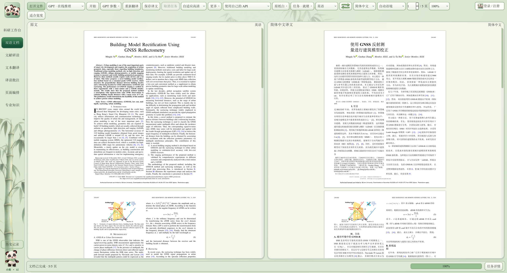

# 小奕译读

面向科研文献的 Windows 双语阅读、PDF 翻译与知识整理客户端。

当前版本 **1.44.2**，加入内置补修与跨文档经验。实际安装后的客户端从空缓存独立处理两篇不同版式的论文，分别 **5/5 页、12/12 页通过**；运行期间没有修改代码或人工补修。详见[本版实测](guides/RELEASE-1.44.2.md)。

## 功能

- **双语文档**：导入 PDF、Word 和图片；保留标题、作者、原文分栏、正文、图表、图注与页脚的逻辑分区，原译文对照。参考文献的文章条目保持原文。
- **内置补修**：局部错误按段落 ID 处理；每段最多追加两轮，反馈拒绝草稿和具体问题，保护数字、链接和公式；成功结果缓存后继续处理独立内容。
- **跨文档经验**：本机保存修复行动和结果；经两篇不同文档的真实 PDF 验证后，符合条件的经验参与后续选择。界面可查看、停用或撤销。
- **阅读与链接**：缩放、同步滚动、中键拖动、专注阅读；保留外链和页内跳转。
- **文献研读**：阅读器、文献助手、选段翻译、问答、笔记和历史成果。
- **文本翻译**：自动识别语言、术语配置与取消，新输入优先。
- **专业知识**：词性、释义、搭配、适用的语法分析及例句；专业说明、示意图、网页图文分别保存，图片支持缩放。
- **批注与页面编排**：文字标记、笔记、页面排序、旋转及导出。
- **科研工作台与账户**：组织文献和资料，保存研究流程；账户中心管理已开通的个人资料、设备和服务权限。
- **离线与网络适配**：内含 Qwen3 4B 本地通道；在线服务跟随当前 Windows 系统网络和 PAC，不绑定代理软件或端口。

## 真实安装界面

图片由本机安装后的客户端在后台实际渲染并直接保存，展示真实论文翻译结果。界面未生成或重绘。两篇整篇实测使用已配置的云端模型；九组功能检查使用受控传输，分别统计。

## 实测结果

| 检查 | 结果 |
| --- | --- |
| 实际安装文件一致性 | 5,387 个文件相符 |
| 冻结程序故障注入 | 18/18 项通过 |
| 安装版功能 | 九组通过 |
| 后台启动交互 | 38 项通过 |
| 5 页真实论文 | 77.203 秒，15.441 秒/页，5/5 页通过 |
| 12 页真实论文 | 107.687 秒，8.974 秒/页，12/12 页通过 |

总时间覆盖解析、OCR、翻译、补修、排版、PDF 校验与合并；并行阶段不直接相加。此表为本机样本实测，其他机器、通道和文档密度会改变耗时。自动检查覆盖内容清单、保护对象、可见字形和重叠，专业语义与精确视觉细节仍需核读。

[本版测试条件与边界](guides/RELEASE-1.44.2.md) · [去敏数据](docs/results/04-validation-1.44.2.json) · [使用指南](guides/USER_GUIDE.md)

## 获取与联系

[官网](https://syj3426962511-glitch.github.io/xiaoyi-reader/) · [账户中心](https://xiaoyi-accounts.xiaoyi-account-deployment.workers.dev/) · [GitHub](https://github.com/syj3426962511-glitch/xiaoyi-reader)

公开功能介绍、实机截图和去敏测试资料。核心代码、私人 API、账户数据和论文全文保留在本机。安装包包含运行环境、OCR 与本地模型，安装路径可自选；其他电脑使用自己的账户授权或 API 配置。获取客户端与交流：[3426962511@qq.com](mailto:3426962511@qq.com)。
