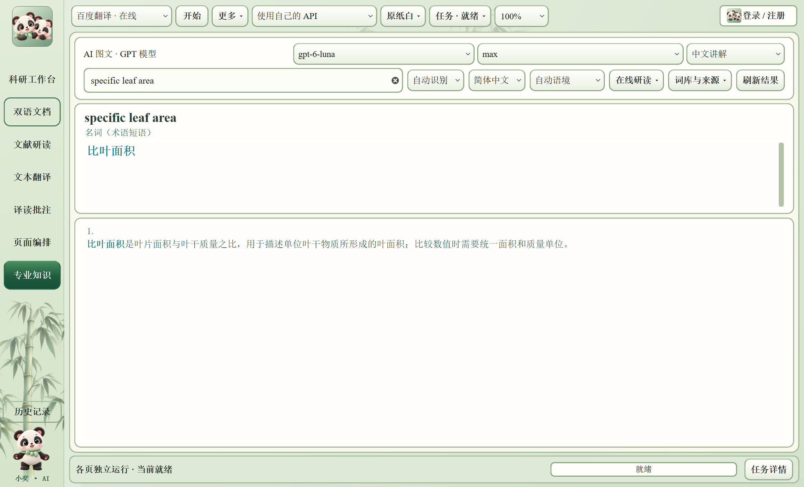
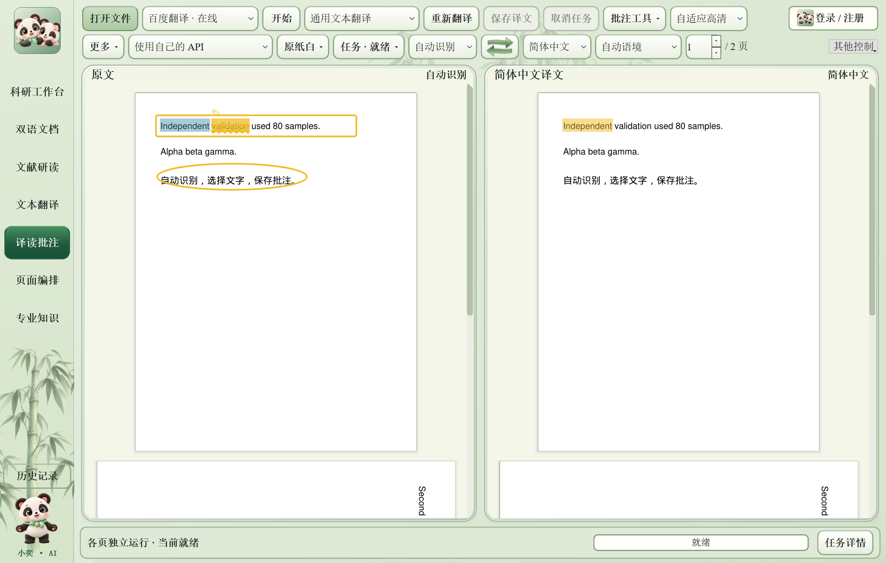

# 小奕译读

面向科研文献的 Windows 双语阅读、PDF 翻译与知识整理客户端。

当前维护线为 **1.44.1**。**修订67已通过实际安装文件一致性、九组功能和12页空缓存真实论文检查**；普通无参数启动交互仍待桌面解锁，正式入口尚未升级。详见[测试记录](guides/TESTING.md)。

## 功能

- **双语文档**：导入 PDF、Word 和图片，原译文对照；保留原文的标题、作者、正文分栏、图表、图注与页脚等逻辑分区，分别排版并校验最终 PDF。
- **阅读与链接**：缩放、同步滚动、中键拖动、专注阅读；保留外部链接和页内跳转。
- **文献研读**：阅读器、文献助手、选段翻译，支持问题记录、笔记与历史成果。
- **文本翻译**：自动识别语言、分段显示、术语配置及取消；新输入优先，旧结果不会覆盖新内容。
- **专业知识**：词性、释义、搭配、适用的语法分析及例句；专业说明、示意图与网页图文独立保存，图片支持缩放。
- **批注与页面编排**：标记、笔记、页面选择、排序、旋转及导出。
- **科研工作台与账户**：组织文献、资料和工作流；账户中心提供已开通的资料、设备与服务权限。
- **离线与网络适配**：Qwen3 4B 本地通道；在线服务读取当前 Windows 系统网络与 PAC，不绑定代理软件或固定端口。

## 本轮检查和优化

修复文档专用参数进入文本引擎导致的配置错误，覆盖文本翻译和研读选段路径；补齐离线朗读脚本，并将它列为安装包必需文件。安装后实测中英文语音合成、停止和切换均通过。

账户中心补齐前端依赖与类型声明，构建通过后已部署。网页及健康接口实测正常；既有设备会话仍有效。七个平台的个人 API 加密配置通过本机读取与格式核查，本轮未逐平台调用付费接口。

普通段落的恢复策略已补齐，并修正单复数英文残留漏检。默认使用自己的 API，后续手动选择持续保存。个人配置在本机加密。公开安装包与私有用户资料分离。

## 真实实机界面

上图由实际安装的修订 66 客户端直接截图，展示本地词典结果，未重绘界面。

批注截图使用本机合成测试文档。功能回归中的 AI 响应采用明确标记的受控传输；这类检查验证界面和数据流程，不作为真实模型翻译质量证据。真实论文与个人配置不公开。

## 测试范围

135 项共享回归通过；实际安装后的检查覆盖页面编排、批注、文献研读、科研工作台、专业知识、图文缓存与图片查看、缩放与朗读、位置状态及科研工作流。新论文仍可能出现需复核的术语、复杂公式及局部位置偏差，完成状态和精确对齐分别记录。

[详细测试结果](guides/TESTING.md) · [使用指南](guides/USER_GUIDE.md)

## 获取与联系

[官网](https://syj3426962511-glitch.github.io/xiaoyi-reader/) · [账户中心](https://xiaoyi-accounts.xiaoyi-account-deployment.workers.dev/) · [GitHub](https://github.com/syj3426962511-glitch/xiaoyi-reader)

公开项目介绍、真实截图和去敏测试资料；核心代码、私人 API 配置、账户数据和论文全文由作者私下保管。账户中心的安装包存储未开通，客户端请联系 [3426962511@qq.com](mailto:3426962511@qq.com)。
