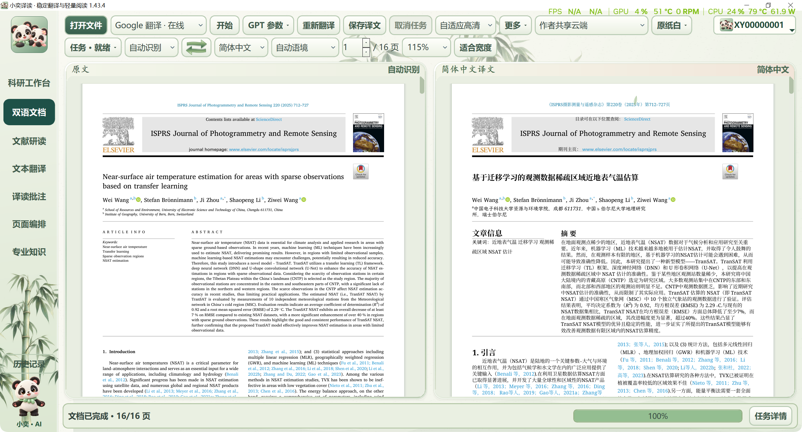

# 小奕译读 · XiaoYi Reader

**面向论文阅读的 Windows 桌面工具：文档翻译、双语对照、专业知识与图文研读。**

[项目网页](https://syj3426962511-glitch.github.io/xiaoyi-reader/) · [功能详解](guides/FEATURES.md) · [截图与测试结果](guides/TESTING.md) · [使用指南](guides/USER_GUIDE.md) · [常见问题](guides/FAQ.md) · [联系作者](mailto:3426962511@qq.com)

> 本仓库公开项目介绍、真实客户端截图、测试结果摘要和学习说明，供参考和学习。如需使用、交流或合作，请联系 **3426962511@qq.com**。

*用户于2026-10-26提供的正式客户端1.43.4桌面截图，真实论文原文与译文，115%缩放，底部显示16/16页完成。原图直接复制，未重绘、拼接、裁切或修改像素。*

截图顶部当前选择为Google翻译；仅凭当前下拉框不能认定这份已有译文由Google生成。下方DeepL统计来自独立的2026-10-25测试记录。

## 项目定位

小奕译读希望把“打开文献、看译文、查术语、理解图表、整理笔记”放在连续的阅读流程中。阅读者可以保留原文位置，随时核对译文中的方法、数字、公式、单位与引用，而不必只依赖一段脱离原文的解释。

项目支持本地与在线翻译入口。在线通道需要相应网络和可用的服务配置；离线能力需要本地模型与运行资源准备就绪。本次 16 页实测使用 **DeepL 在线通道**，不应解释为整篇离线性能证明。

## 主要功能

| 功能 | 具体用途 | 本轮证据范围 |
| --- | --- | --- |
| PDF 翻译与双栏对照 | 逐页查看原文与译文；跟踪翻译、排版和显示进度；导出中文及双语资料 | 16 页授权样本完成，240 个翻译区域渲染 |
| 标题与版面适配 | 标题保留层级、较大字号和加粗；正文优先 11 磅，密集区域适度调整；图名和表格独立适配 | 本样本正文 9–11 磅；保持 16 页 |
| 链接、公式与原图 | 保留原始链接动作、原生公式与图像对象，阅读时可以回到来源 | 261 个源/译文链接通过核对 |
| 文本翻译 | 面向选段或输入文字的翻译与阅读；可配合术语和语言设置 | 具备入口，通道响应取决于实际配置 |
| 三栏文献研读 | 原文、文献助手、选段译文并列；支持调整栏宽并保存 | 默认约 60% / 22% / 18% 和布局记忆通过检查 |
| 专业知识 | 释义、词性、读音、词形、搭配、语法、时态语态、双语例句和专业解释 | 本轮未新增在线知识质量测试；暂不提供该页面的新实机截图 |
| GPT / 网页图文 | 分区查看图文内容；点击图片完整查看、缩放与拖动；保留缓存与滚动位置 | 实际控件事件与本地缓存回归通过 |
| 批注与页面整理 | 阅读中选字、高亮、记录笔记，并通过页面编排入口整理资料 | 保留相关入口；不把导航测试等同于全部编辑操作已验证 |
| 专注阅读与移动 | F11 专注模式；按住鼠标中键可上下左右移动页面 | 专注模式与图片中键拖动有独立交互测试记录 |
| 科研工作台 | 提供文献、笔记、任务草稿等组织入口，按需加载工具 | 检查导航、按需加载及数据库占用时的草稿与界面响应 |
| 自适应检查 | 保存问题案例、成功译文缓存，复用受约束的修复规则 | 不等于云模型自行训练或程序任意自我改写 |

更详细的行为、适用边界与阅读步骤见[功能说明](guides/FEATURES.md)。

## 真实测试结果：1.43.4

测试日期：**2026-10-25**；公开资料整理日期：**2026-10-26**。样本为在本机授权处理的 16 页学术 PDF，使用用户当时选定的 DeepL 通道。原文与译文不随本仓库公开，避免传播第三方论文全文。

| 指标 | 实际记录 |
| --- | ---: |
| 原文 / 译文页数 | 16 / 16 |
| 已渲染 / 应处理翻译区域 | 240 / 240 |
| 句段记录（含标题和标签） | 491 |
| 目标语言记录 / 按规则保留原样 | 477 / 14 |
| 失败 / 等待 / 未完成区域 | 0 / 0 / 0 |
| 原文 / 译文超链接 | 261 / 261 |
| PDF 自动硬问题 / 未关闭复核项 | 0 / 0 |
| 同版本打包客户端交互检查 | 53 项通过 |
| 当前公开截图 | 1 张用户提供的正式客户端原始桌面截图 |
| 文件任务耗时 | 358.563 秒 |
| 含启动、显示和测试操作的客户端耗时 | 390.156 秒 |
| 成功句缓存命中 / 新句翻译 | 460 / 31 |

**速度记录的条件不能省略：**这次是混合缓存复译，且同机正在构建程序和迁移资料。上述时间不能用来承诺全新 20 页文档的首译时长，也不能直接与一次失败的旧任务计算加速倍数。

[完整测试说明](guides/TESTING.md) · [结果 JSON](docs/results/validation-1.43.4.json) · [16 页逐页结果](docs/results/per-page-1.43.4.json) · [截图来源 JSON](docs/results/screenshot-verification.json)

## 实机截图

用户于2026-10-26提供的正式客户端1.43.4桌面截图，真实论文原文与译文，115%缩放，底部显示16/16页完成。原图直接复制，未重绘、拼接、裁切或修改像素。

图片可在[项目网页的截图区](https://syj3426962511-glitch.github.io/xiaoyi-reader/#gallery)完整查看、放大缩小与拖动。

此前的六张离屏演示截图已从当前展示撤下。它们使用人工编写的文档、词条和图像，不能代表正式客户端的实际内容和外观。其他功能页面待取得实机内容后再补充。

[截图与来源说明](guides/SCREENSHOTS.md)。

## 使用方式

1. 如需客户端或进一步资料，请通过 **[3426962511@qq.com](mailto:3426962511@qq.com)** 联系。
2. 获得完整安装包或程序目录后，按所附说明启动；不要只复制单个 exe 后丢弃依赖。
3. 选择可用的翻译通道，打开 PDF，确认源语言与目标语言；源语言支持自动识别。
4. 在任务状态中区分“句段翻译、页面排版、页面显示”；中断或部分完成时先查看具体原因。
5. 完成后对照原文核读术语、数字、公式和图表，再导出所需资料。

仓库网页用于展示与学习，**不提供浏览器端 PDF 上传或在线翻译服务**。

## 已知边界

- 原生图片可以保留，但图片中已有的文字不代表已被逐字翻译。
- 该样本图 12 中气象 station 被译为“基站”，更贴合领域的用语是“台站/观测站”；作者贡献中的人名仍需结合原文核读。
- 自动完整性和几何检查不能认证每一句科学含义完全正确，也不保证所有未来 PDF 都能保持同样效果。
- 复杂扫描件、密集表格、异常字体和网络波动可能需要额外处理；本轮结果不能替代对应类型的实际测试。
- 图文截图验证使用本地缓存；没有据此宣称 GPT 图文和网页来源在所有网络环境都持续可用。

## 公开范围、第三方组件与联系

本项目使用相关文档、模型与界面生态中的第三方组件。公共资料中的高层流程说明仅供学习，第三方组件的权利与许可见其原项目，例如 [BabelDOC](https://github.com/funstory-ai/BabelDOC)、[PyMuPDF](https://github.com/pymupdf/PyMuPDF) 和 [Qt for Python](https://doc.qt.io/qtforpython-6/)。此仓库不重新分发这些组件、模型权重或客户端二进制。

公开范围见 [PUBLICATION_SCOPE.md](PUBLICATION_SCOPE.md)，资料使用说明见 [LICENSE](LICENSE)。仓库公开不代表核心软件采用开源许可证。

**联系邮箱：3426962511@qq.com**  
如需客户端、技术交流、试用或合作，请说明用途、操作系统、文档类型和遇到的问题。请勿在公开 Issue 中粘贴账号密钥或未获许可的文档。
