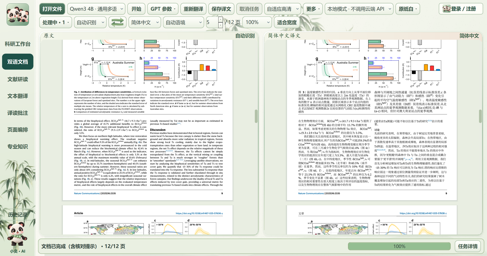

# 小奕译读 · XiaoYi Reader

**Windows文献阅读工具：双语PDF、本地翻译、研读笔记、专业知识和图文阅读。当前验证版本：1.43.20。**

[官网与下载](https://xiaoyi-reader.syj3426962511.chatgpt.site/) · [账户中心](https://xiaoyi-reader-accounts.syj3426962511.chatgpt.site/) · [项目网页](https://syj3426962511-glitch.github.io/xiaoyi-reader/) · [详细功能与实测](guides/RELEASE-1.43.20.md) · [去敏结果](docs/results/validation-1.43.20.json)

实际安装后窗口的原始截图，论文采用CC BY 4.0，右栏为机器翻译。未生成或重画界面。截图像素、原文来源、适用范围见[版本说明](guides/RELEASE-1.43.20.md)。

## 功能

| 功能 | 用途 |
| --- | --- |
| 双语文档 | PDF、Word和图片导入；原文与译文并排、分步进度、中文及双语PDF导出。 |
| 正文与原生对象 | 正文优先11磅并在原页适配；表格、图名、脚注独立适配；保留原图、原生公式和上下标。密集正文以实际字形测量分配同栏空间。 |
| 完整性与恢复 | 逐句登记、数值与模型编号保护、原生对象数量与实际PDF核验；旧缓存重检，有限次数补译；未解决错误如实显示。 |
| 本地与在线通道 | 内置Qwen3 4B及CUDA/Vulkan运行资源；在线通道按用户实际账户和配置使用。本轮整篇验证使用本地CUDA。 |
| 阅读操作 | 原文和译文超链接、同步位置与缩放、鼠标中键拖动；F11专注阅读收起底部任务状态。 |
| 文献研读 | 原文、文献助手、选段译文三栏；默认约60%/22%/18%，保存个人栏宽、笔记和阅读位置。 |
| 专业知识 | 词性、读音、词形、搭配、语法、时态语态、双语例句和专业解释；按词项是否适用显示。 |
| AI与网页图文 | 分别保存词典、专业解释与示意内容；来源和模型结果分区；切换复用结果；完整图片窗口支持缩放、平移和适合窗口。 |
| 批注与编排 | 选字、高亮、笔记及页面导入、排序和导出；科研工作台保存项目、过程和结果。 |
| 账户与数据 | 本地访客使用不要求登录；账户中心提供实际已开通的登录与邮件能力；未开通的第三方或短信入口不伪装成可用。 |
| 轻量显示与保存 | 按需载入页面工具、后台渲染和异步数据库保存；阅读计时入队，数据库占用时保留待保存记录。 |

## 本轮测试结果

- 本地Qwen处理两篇真实论文：10页和12页，保留原页数；回填分别165/165和113/113个区域，失败/等待均为0，实际PDF阻断问题为0。
- 12页使用实际安装版的正常启动和打开文件流程，无复制译文缓存：1329.266秒，首批译文预览394.094秒。10页复用前轮真实缓存：360.532秒。两种条件分别报告，不据此承诺任意20页耗时。
- 冻结客户端13组功能回归、27个原生符号组合用例通过。安装后的5027个生产文件逐个核对无差异；卸载保留用户数据。
- 保留图内原文标签核对提示；自动检查不等同于专业语义人工审校。在线图文质量本轮未新增付费调用。

[完整说明与另外两张实际页面](guides/RELEASE-1.43.20.md) · [测试摘要JSON](docs/results/validation-1.43.20.json)。

## 使用与资料范围

从[官网](https://xiaoyi-reader.syj3426962511.chatgpt.site/)获取完整安装包，核对版本及SHA-256；安装于D盘后打开文献，选择原文和目标语言并开始。在线通道需要可用账户和服务配置；本地翻译使用内置Qwen模型。文本密度、硬件与缓存会影响速度，异常扫描件和复杂版面仍可能需要处理。

该仓库供参考和学习，公开介绍、真实截图及结果；暂不公开核心业务代码，不存放个人密钥、笔记、词库、论文全文、模型权重或客户端二进制。第三方组件的说明和许可随产品提供，相关原项目见[BabelDOC](https://github.com/funstory-ai/BabelDOC)、[PyMuPDF](https://github.com/pymupdf/PyMuPDF)、[Qt for Python](https://doc.qt.io/qtforpython-6/)。

历史验证：[1.43.9](guides/RELEASE-1.43.9.md)、[1.43.7](guides/RELEASE-1.43.7.md)、[1.43.4](guides/TESTING.md)。历史数据具有各自的样本与条件，不作为本版结果。

**联系：[3426962511@qq.com](mailto:3426962511@qq.com)**。欢迎使用交流、反馈与合作。
