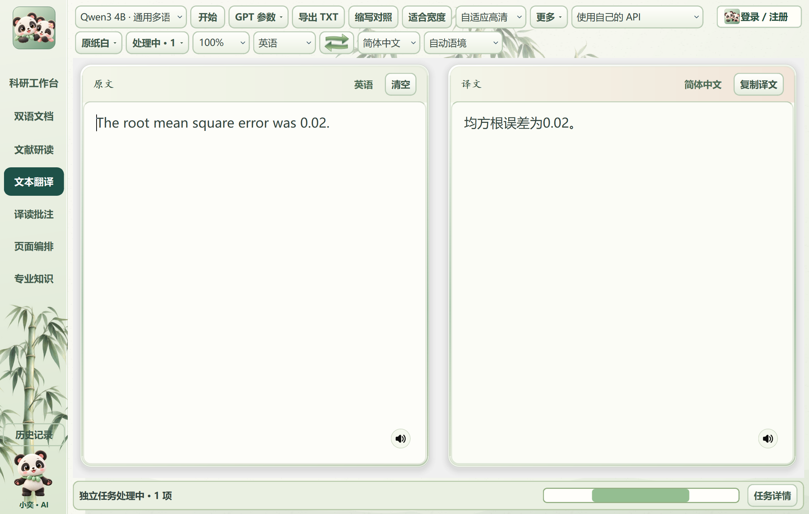

> 1.43.29暂缓交付：普通启动发现SSL依赖漏打包，正在修复和重新验收。此前文档测试通过不代表完整产品验收通过。

# 小奕译读 1.43.29

面向科研文献的 Windows 双语阅读、PDF 翻译与知识整理客户端。

服务来源默认“作者共享云端”；个人 API 配置和所选模型保留，之后的手动选择按页面保存。个人配置在本机加密，工厂安装包包含程序、模型和必要依赖。

## 本版修复

采用“全文先处理，末尾补修”。段落解析或翻译失败后继续后续内容；整体解析异常逐页隔离，单页失败继续后页。全文处理结束后，复用已通过句子并使用原通道补修失败内容，最多两轮。任务详情分别显示已处理页数、校验通过页数与剩余问题。取消仍由用户控制。

修正日期、国家简称、方程引用、时间格式、MOST 大小写和网址句末标点的误判；原生比值的分子、分母整体保护，避免把分母识别为图面板。真实公式或数值丢失继续拦截。前台按当前文档持有修复锁，后台维护的运行或暂停不再跳过当前任务补修。平台失败后仍复用已通过的缓存。规则按错误类型作用于后续文档，原文与已完成内容保留。

## 真实客户端页面

实际安装的程序使用 Qwen3 4B 翻译自有示例文本。图片由运行中的客户端自身保存，保留原始界面像素，未重绘；包含客户端内容区，不包含 Windows 系统标题栏。私人论文、账户和 API 配置不公开。

## 功能

- **双语文档**：PDF、Word 和图片导入，原译文并排；逐页预览、缩放、同步滚动与保存。正文优先 11 磅，表格、图名和脚注分别适配，保持原页数。
- **阅读交互**：按住鼠标中键拖动上下左右位置，专注阅读隐藏底部任务区；原文与译文保留外部链接和页内跳转。
- **文献研读与批注**：独立阅读视图，支持选段、笔记、标记、历史记录、页面编排与导出。
- **文本翻译**：自动识别原文语言，输入后分段更新，切换模型与术语后重新处理；旧请求结果不会覆盖新输入。
- **专业知识与图文**：词典、适用的语法/时态/语态与双语例句，专业说明与示意内容分别保存；AI 图文和网页来源独立缓存，图片可完整查看、缩放和拖动。
- **科研工作台与账户**：组织项目、资料与任务；账户中心管理资料、设备和已开通权限。本地模式使用内置 Qwen3 4B。
- **网络适配**：读取当前 Windows 系统网络与 PAC，需要时使用系统代理；本机模型直连，不绑定代理软件、端口、订阅或节点。

## 使用

打开文件，选择所需通道和目标语言后开始。作者共享云端需要已登录账户及对应共享权限；使用自己的 API 可在本机填写平台配置；本地 Qwen3 4B 可在资源完备时离线运行。已有任务保留开始时选择的服务来源。

完成状态依据应译区域回填和实际 PDF 核验。原生公式、参考文献、出版信息及部分图内标签可原样保留，核对提示另列；自动检查覆盖结构和完整性，科学语义仍需结合原文核读。两轮仍无法可靠恢复时保留失败位置与断点。

## 实际安装测试

| 实际安装测试 | 完成页数 | 回填/应译区域 | 失败/等待句 | PDF阻断问题 | 耗时 |
|---|---:|---:|---:|---:|---:|
| 15页原失败任务，真实译文复检补译 | 15/15 | 148/148 | 0/0 | 0 | 4.87 分钟 |
| 8页新文档，本地翻译 | 8/8 | 114/114 | 0/0 | 0 | 8.84 分钟 |

15页复用原 DeepSeek 真实旧译文，由本地 Qwen3 4B 复检补译；8页使用本机 Qwen3 4B，无该文献既有译文。两篇23页均通过本次结构与完整性验收，原件不变。5,028个生产文件实际安装后逐一一致；245个应用模块、182个BabelDOC模块、13组冻结功能检查和55项专门规则回归通过。耗时仅对应本机样本。[详细结果](guides/TESTING.md)。

## 获取与联系

[官网](https://syj3426962511-glitch.github.io/xiaoyi-reader/) · [账户中心](https://xiaoyi-accounts.xiaoyi-account-deployment.workers.dev/) · [GitHub](https://github.com/syj3426962511-glitch/xiaoyi-reader) · [实机结果](https://syj3426962511-glitch.github.io/xiaoyi-reader/validation/)

公开介绍、实机截图和去敏测试资料；核心代码、私人配置和论文全文由作者私下保管。安装包在线存储尚未恢复，未开通 R2。需要客户端或交流开发，请联系 [3426962511@qq.com](mailto:3426962511@qq.com)。
