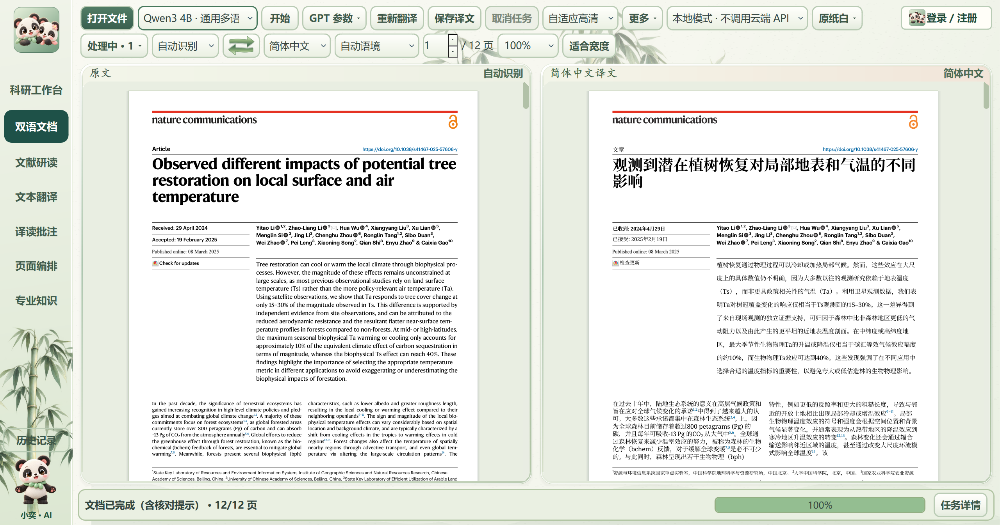
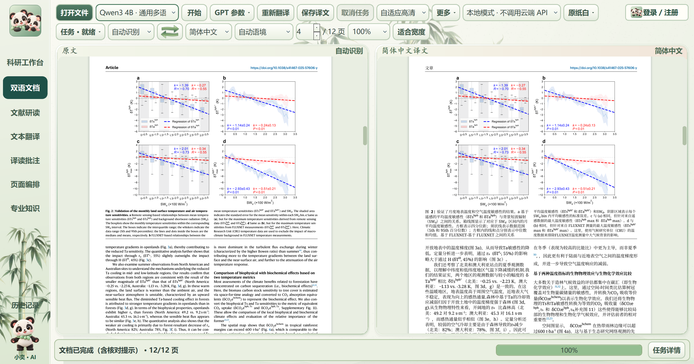
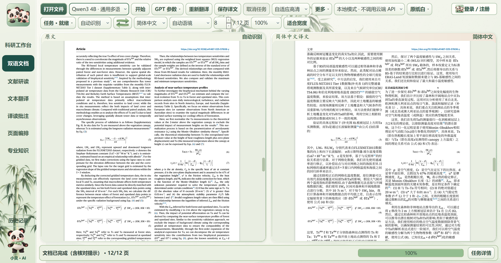

# 小奕译读 1.43.21：实机验证与发布说明

本版将原生字母、上下标及完整数值保护作为所有文档共用的规则，不依赖论文文件名。修复小数尾部被拆行的问题，包括原生公式与普通文字共同组成一个数值、同一公式跨接两个小数的情况。导出后按实际字形原点再次核对数值是否完整显示。全文翻译优先保持整句语义和中文语序，程序负责精确保留公式、数值、网址及编号。排版使用实际字形测量密集段落的空间需求。

| 实际样本 | 页数 | 回填区域 | 失败/等待 | 实际PDF阻断问题 | 耗时与条件 |
| --- | ---: | ---: | ---: | ---: | --- |
| NG10 | 10 | 165/165 | 0/0 | 0 | 386.563秒；复用上一轮真实句子缓存 |
| NC12 | 12 | 113/113 | 0/0 | 0 | 313.141秒；安装版复用1.43.20真实冷启动译文缓存；重新生成PDF |

安装版从正常启动界面进入，使用“打开文件”处理原始12页PDF，源语言自动识别，使用本地Qwen通道及真实前轮句子缓存。1.43.21仅调整排版及实际PDF核查，推理逻辑未改；复用缓存不代表本轮冷启动翻译速度。首批译文预览为53.281秒。原始文件指纹保持不变。两篇论文均保持原页数。NG10与NC12分别有38和21个图表/公式原文词项核对提示，不作为已翻译图片文字宣传。

13组冻结功能回归全部通过；另有27个原生符号几何组合用例、6项数值换行回归及13项保护、重排和失败恢复单元检查。安装包实际安装后，5027个生产文件逐个与打包清单比对，缺失、额外、不同文件均为0；实际启动和全文任务通过，卸载测试确认用户资料保留。

本轮还保留了失败摘要：18候选在新12页论文上暴露粘连图号及模型重复生成；19候选暴露公式密集段落的估算空间不足。1.43.20的实际安装版冷启动12页全文成功；随后人工查看导出PDF发现小数拆行，1.43.21补充通用数值换行与输出检查并重跑相关流程。没有将失败记录改成完成。

## 功能

| 功能 | 说明 |
| --- | --- |
| 双语文档 | PDF、Word和图片导入；原文与译文并排、分步进度、中文及双语PDF导出。 |
| 正文与原生对象 | 正文优先11磅并在原页适配；表格、图名、脚注独立适配；保留原图、原生公式和上下标。密集正文以实际字形测量分配同栏空间。 |
| 完整性与恢复 | 逐句登记、数值与模型编号保护、原生对象数量与实际PDF核验；旧缓存重检，有限次数补译；未解决错误如实显示。 |
| 本地与在线通道 | 内置Qwen3 4B及CUDA/Vulkan运行资源；在线通道按用户实际账户和配置使用。本轮整篇验证使用本地CUDA。 |
| 阅读操作 | 原文和译文超链接、同步位置与缩放、鼠标中键拖动；F11专注阅读收起底部任务状态。 |
| 文献研读 | 原文、文献助手、选段译文三栏；默认约60%/22%/18%，保存个人栏宽、笔记和阅读位置。 |
| 专业知识 | 词性、读音、词形、搭配、语法、时态语态、双语例句和专业解释；按词项是否适用显示。 |
| AI与网页图文 | 分别保存词典、专业解释与示意内容；来源和模型结果分区；切换复用结果；完整图片窗口支持缩放、平移和适合窗口。 |
| 批注与编排 | 选字、高亮、笔记及页面导入、排序和导出；科研工作台保存项目、过程和结果。 |
| 账户与数据 | 本地访客使用不要求登录；账户中心提供实际已开通的登录与邮件能力；未开通的第三方或短信入口不伪装成可用。 |
| 轻量显示与保存 | 按需载入页面工具、后台渲染和异步数据库保存；阅读计时入队，数据库占用时保留待保存记录。 |

## 实机图片与来源

截图来自实际安装后的客户端窗口，原始像素直接复制，没有重画、拼接、裁剪或生成界面。窗口大小取决于测试电脑的分辨率和系统缩放。截图中的论文为Yitao Li等2025年论文，[原文与DOI](https://doi.org/10.1038/s41467-025-57606-y)，原文采用[CC BY 4.0](https://creativecommons.org/licenses/by/4.0/)；右栏为机器翻译改编。

## 验证范围

自动检查确认本次样本的记录、原生对象、版面和链接等结果，不能替代逐句专业人工审校，也不能证明任意未来PDF或扫描件都能无误处理。图像内文字和异常字体仍需核对。在线知识生成与图像服务本轮未新增付费调用，控件/缓存回归通过不等于已验证所有在线服务的内容质量。没有受控的全新20页基准，不按页数直接承诺速度。

“自适应”指受约束的检查、缓存和有限修复，不会自行训练模型权重或改写可执行程序。

## 下载、校验与联系

[官网与安装包](https://xiaoyi-reader.syj3426962511.chatgpt.site/) · [账户中心](https://xiaoyi-reader-accounts.syj3426962511.chatgpt.site/) · [项目网页](https://syj3426962511-glitch.github.io/xiaoyi-reader/) · [去敏测试JSON](../docs/results/validation-1.43.21.json)

安装包SHA-256：`ad873a8a09328637d8f604faada07ca3786259208fdbd83a3e6af04a3a83f3eb`；3,828,548,580字节。客户端EXE SHA-256：`9b62903c81cab806ecdabdb25c315612b204b1685f245a89145929ceff8209e3`。

公开仓库仅提供说明、测试摘要和真实截图，核心代码、账户凭据、个人词库笔记及论文全文不上传。联系：[3426962511@qq.com](mailto:3426962511@qq.com)。
