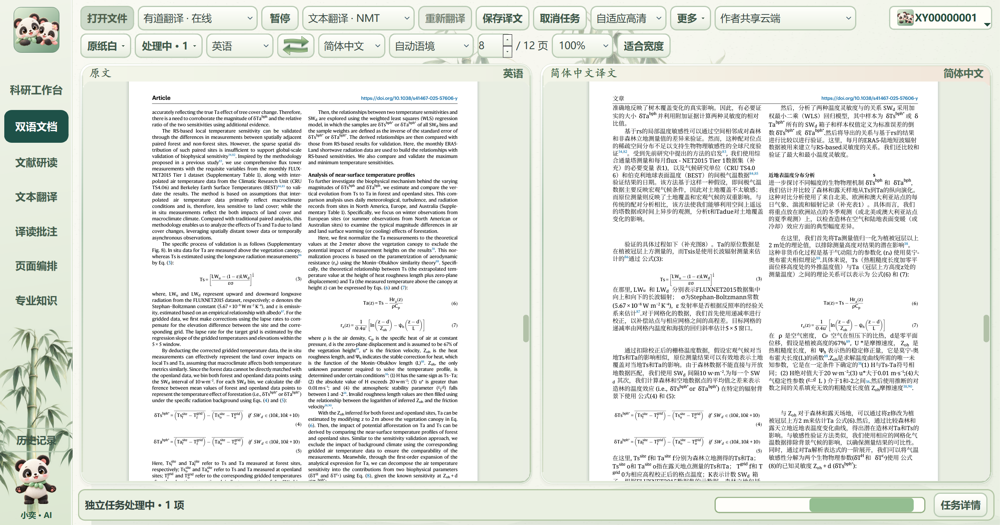

# 小奕译读 1.43.7：实机验证与完整产品入口

更新日期：2026-10-27。Windows 客户端用于文献翻译、双语对照、专业知识、图文理解、批注与科研资料整理。联系：**3426962511@qq.com**。

- [产品官网与下载](https://xiaoyi-reader.syj3426962511.chatgpt.site/)
- [账户中心](https://xiaoyi-reader-accounts.syj3426962511.chatgpt.site/)
- [GitHub 公开资料](https://github.com/syj3426962511-glitch/xiaoyi-reader)
- [项目展示网页](https://syj3426962511-glitch.github.io/xiaoyi-reader/)

## 本版处理的问题

完整句段先翻译，再恢复原生公式、上下标、数值、引用和链接。修复公式与普通句子混排时语义被拆散、CO₂上下文破坏，以及文字粘连等问题。正文优先11磅，密集页面适度调整；表格和图名按自身空间适配，保持原页数。只对实际缺失区域补译，复用已有成功句缓存。

翻译完成与排版提示分别记录。缺失内容仍会标为待处理，不能通过改成“完成”掩盖漏译。字号、样式恢复提示可以存在于完整导出任务中。

## 真实验证结果

| 项目 | 结果 |
| --- | --- |
| NPJ样本 | 13页，134/134需处理区域，未完成0 |
| Nature Communications样本 | 12页，113/113需处理区域，未完成0 |
| Applied Energy样本 | 16页，198/198需处理区域，未完成0 |
| 三份输出检查 | 41页逐页图像对照，自动PDF检查硬问题0、复核项0 |
| 最终无应用Python源码的打包客户端 | 本机真实有道在线任务12/12页，待核对0段；363条译文、2条规则保留 |
| 最终客户端输出复检 | 硬问题0、复核项0 |
| 针对性回归 | 20项通过：数字、单位、公式、引用、原生对象、CO₂语义等 |
| 后台自动修复隔离测试 | 人为移除1条超链接，自动修复后问题1→0；付费翻译请求0 |

最终打包客户端本次用时255.578秒（约4分16秒），复用了已有句缓存，不能作为全新文档首译速度。另一次16页冷缓存首译约468秒，留下1项未完成，随后补译复核通过；不把失败的首轮记录包装为一次成功完成。

这些结果是已测试样本的结构、完整性和版面证据，**没有认证每句科学含义，也不保证任意未来PDF均无错误**。原始图中文字、参考文献、作者及数学对象可按规则保留。译文仍应核读专业术语、公式与数值的科学含义。

## 功能与使用

双语文档支持原文/译文并列、页面缩放、超链接、按住鼠标中键平移、专注阅读以及中文PDF导出。文献研读提供原文、助手和选段译文三栏。专业知识页提供词典、语法用法、双语例句、专业解释和图文入口；图片支持完整查看、缩放与拖动。科研工作台、批注和页面编排用于整理阅读资料。详细步骤见[功能说明](FEATURES.md)和[使用指南](USER_GUIDE.md)。

本轮新增验证集中在文档与后台修复；没有把上述所有功能都重新做全套网络实测。账户中心实际健康接口、现有账户会话读取已验证；邮箱验证与ChatGPT登录入口可用性由服务配置决定，QQ/微信/短信接入未启用。

自适应检查保存问题、持久化修复任务及可复用的受约束规则。此次验证了跨进程的链接修复闭环。它不是云模型权重自动训练，也没有证据表明能任意改写算法并保证所有新文档正确。程序完全关闭时必须有独立后台进程才可继续计算；未运行的任务可在下次启动恢复。

## 截图来源与公开范围

图片来自本机正式打包客户端对真实论文的任务窗口，原图直接复制，未重绘、拼接或修改像素；窗口内容抓取不包含Windows标题栏。截图仍显示独立任务处理中，12/12完成数字取自同次任务记录。不会将这张图当成完成状态的视觉证据。

公开仓库只提供说明、原始实机截图和去除本机路径的结果摘要，不含核心代码、账户凭据、用户配置或论文全文。安装包由官方产品入口分发，保留运行依赖和第三方许可证；不在本仓库提交安装包。需要完整资料、试用或合作请联系3426962511@qq.com。

安装验证补充：实际安装成功，安装后程序与最终构建哈希一致；常规启动和全新配置启动均正常退出（退出码0）。首次启动测试曾出现窗口关闭后进程驻留，随后诊断与两次复测未复现，根因仍未确定，已记录为待观察项。
