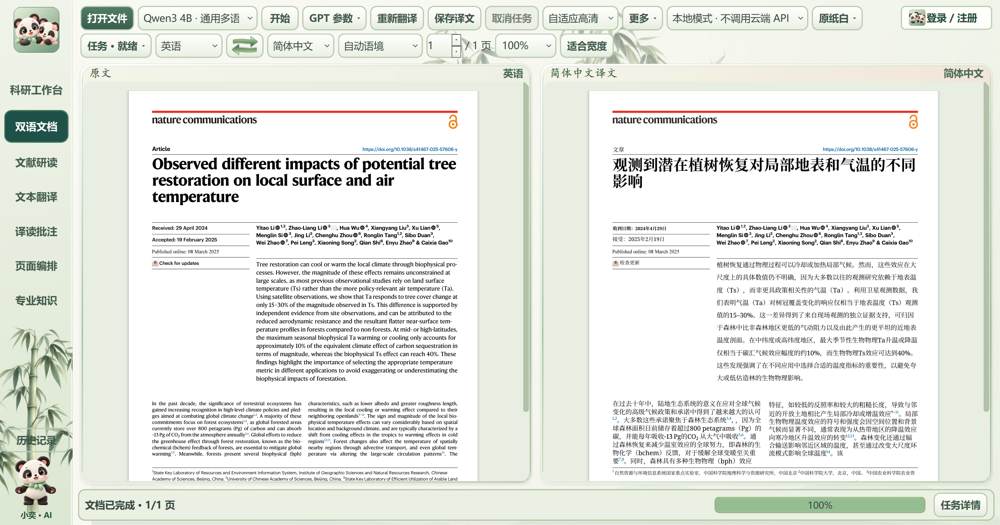

# 1.43.9：段落对齐与翻译恢复

**状态：改进版，仍有需要人工核对的内容。** 本版针对重复出现的“部分完成”、本地 Qwen 崩溃和段落上下边界错位进行了修复与实机测试。图表标签、图中位图文字及极端版面尚未全部自动处理，不能保证所有 PDF 均无遗漏。

## 实机验证

- 本地 Qwen3 4B 客户端对一篇 10 页文献运行：160/160 个被识别正文区域有输出，0 个未完成正文区域；实际显示原文和译文。411 条句子来自缓存，2 条为新译；用时 201.53 秒，不代表首次翻译速度。
- 另有一篇开放许可论文的第 1 页独立无缓存测试：29 条新句，9/9 个识别区域有输出，用时 543.06 秒；测试与打包、安装同时进行，不能作为一般耗时估计。该截图来自 1.43.9 v7 验证候选版；正式 v8 仅补充旧任务自检兼容修复。
- 10 页测试中 65 个多行段落的末尾位置偏差中位数由 7.60 磅降到 0.26 磅；3 个段落仍超过 11 磅，最大 16.69 磅。行距为原页容纳与阅读性而调整，不能保证每段始末完全重合。
- 自检发现 46 个原有图表或公式词项需要核对，分布在 4 页；另有 38 条被保留的符号或标签需核对。它们不计入正文完成数；图内位图文字也可能未被自动识别。
- 同一 10 页样本的 209 个有效超链接目标经检查未丢失；不代表所有复杂 PDF 的链接位置都已经正确。
- Windows 安装包已隔离安装并启动检查，安装后客户端程序哈希与打包候选一致。

## 处理逻辑与限制

修复缓存回填模式与原排版输入不一致、部分公式数字误判、线程数据库关闭和无控制台标准输出问题。未完成内容使用原翻译通道重试并保留已完成成果，无法自动修复时明确标记，不把结果伪装成完成。对识别到的段落，在保留内容、公式和原有框架的前提下调整位置和行距。文字准确性、公式、图表、位图文字、密集表格及超链接仍需按实际文件核查。

## 真实截图与署名

截图为本机真实客户端窗口，源文献仅截取第 1 页做测试；右侧为机器翻译，属于对原文的改编，不代表作者或期刊认可本产品。来源：Yitao Li 等（2025），[Observed different impacts of potential tree restoration on local surface and air temperature](https://doi.org/10.1038/s41467-025-57606-y)，Nature Communications，© 作者，[CC BY 4.0](https://creativecommons.org/licenses/by/4.0/)；授权范围依原文说明，第三方素材可能另有限制。截图原图未重绘、拼接或修改像素。图片 SHA-256：`c2ef2a5294e5a9a52f1dbaf0c656980a814b3dbb861e0d7a73addd7a38df4aa8`。

[官网与下载](https://xiaoyi-reader.syj3426962511.chatgpt.site/download/) · [账户中心](https://xiaoyi-reader-accounts.syj3426962511.chatgpt.site/) · [联系作者](mailto:3426962511@qq.com)
