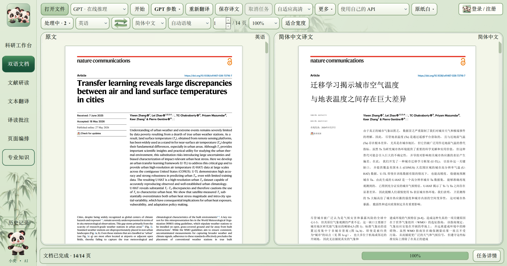
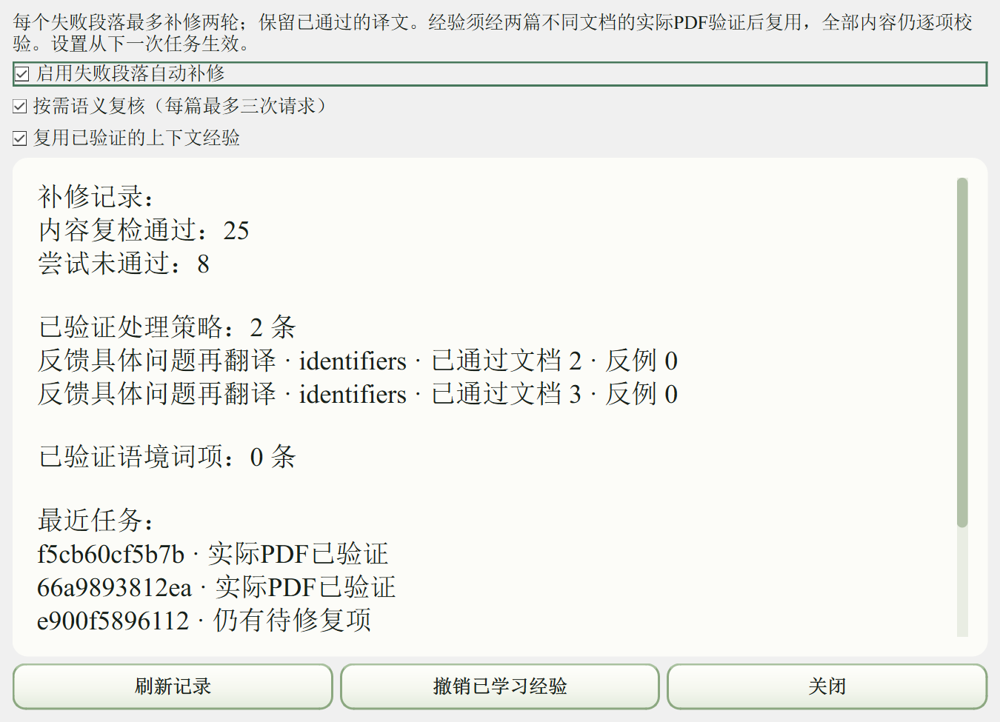

# 1.44.3 引用恢复与经验复用

2026-11-10 完成冻结安装包、中文及空格路径安装、运行文件对照、两篇整篇论文和原生 Windows 窗口验收。1.44.1·修订68原目录保留。

## 修复内容

- 数字和上标引用在翻译前按结构保护。OCR 将上标54、55读为54、5时，结合两次缩放识别及彩色升高像素恢复；普通正文数字保持独立判断。
- 原文的公式编号与参考文献角标分开识别，避免将“equations[54]”误译成“公式54”。算法使用像素与位置证据，未建立针对某篇论文的词表。
- 跨物理文本框的 URL 使用原文链接注释恢复，链接按原始节点归属绑定；同域名多条链接存在歧义时继续检查。最终合并 PDF 再核对原始可点击 URI。
- 修复经验按错误类型、语言、文本类别、上下文和保护对象结构匹配。经至少两篇不同文档的最终 PDF 验证，并且成功多于失败后，才参与后续选择；反例降低置信度或停用。
- 已验证经验可在下一篇翻译前启用对象保护；旧版有效经验继承。语境词项必须有原文证据及跨文档验证，界面可查看、停用和撤销。
- 补齐应用、启动窗口、主窗口图标；安装快捷方式显式指定ICO资源。本机旧快捷方式已重新指向正式新版目录。

## 实际安装版测试

| 检查 | 结果 |
| --- | --- |
| 冻结运行文件 | 5,387个文件与实际安装结果逐项匹配 |
| 编译模块 | 281个模块与冻结源码锁相符 |
| 冻结程序故障注入 | 24/24项通过 |
| 原生Windows窗口与交互 | 44项通过，含窗口图标及关闭选择“否” |
| 14页迁移学习论文 | 253.110秒，18.079秒/页，14/14页通过 |
| 5页GNSS建筑模型论文 | 72.000秒，14.400秒/页，5/5页通过 |

测试使用已配置GPT通道，gpt-6-luna、low。初次安装的本地OCR/译文缓存为空，第二篇为不同文档，其OCR复用0页。两篇运行期间未修改业务代码或人工补修。总时间从解析至最终译文，包含OCR、网络等待、翻译、补修、排版、校验与合并；并行阶段不直接相加。

14页任务追加18次修复、13次内容检查通过、5次尝试未通过，最终所有页面通过。5页任务追加1次修复并通过，实际复用1次已验证结构经验。这些计数描述局部尝试，最终整篇结果分别为14/14、5/5。

参考文献的文章条目保留原文。独立复核重新打开最终PDF，检查页数、目标文本清单、可见墨迹/行重叠和原始可点击URI；原失败段落额外检查54、55及引用语义。自动检查覆盖上述项目，专业语义与细致视觉质量仍需核读。当前样本不代表所有文档均已测试。

截图直接来自本机实际安装程序的原生Windows窗口，使用独立后台桌面，未生成或重绘界面，未操作用户前台鼠标。

## 获取

单文件安装包包含运行环境、OCR、布局模型、字体及本地翻译模型，可选择安装路径。约3.97GB，由作者提供：[3426962511@qq.com](mailto:3426962511@qq.com)。本机7项个人API配置已加密继承；公开安装包不包含私人凭据，其他电脑使用自己的授权或API。无需指定RTX5060，具备CPU运行路径，实际速度依硬件和文档变化。

客户端调整策略、对象保护和版面参数；程序代码由版本更新交付。经验复用不会跳过数字、链接、公式和PDF可见内容检查。
