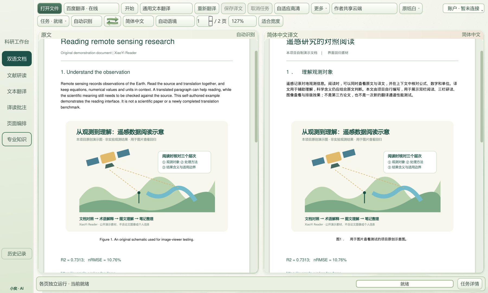
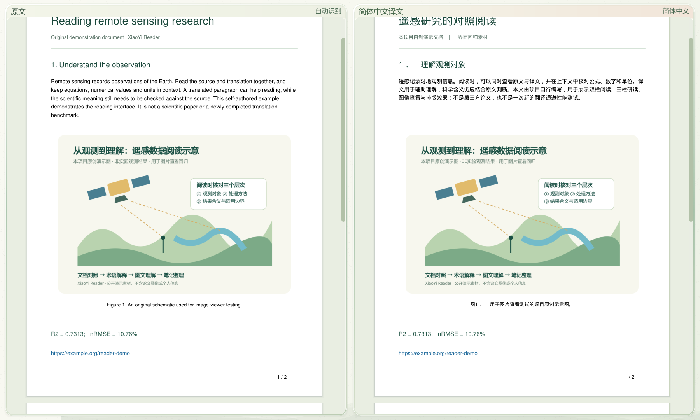
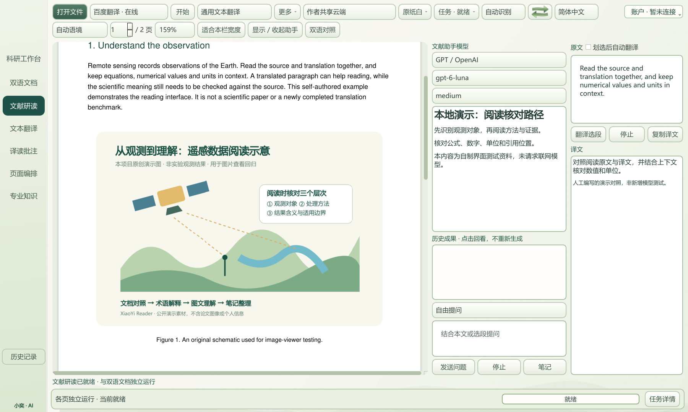
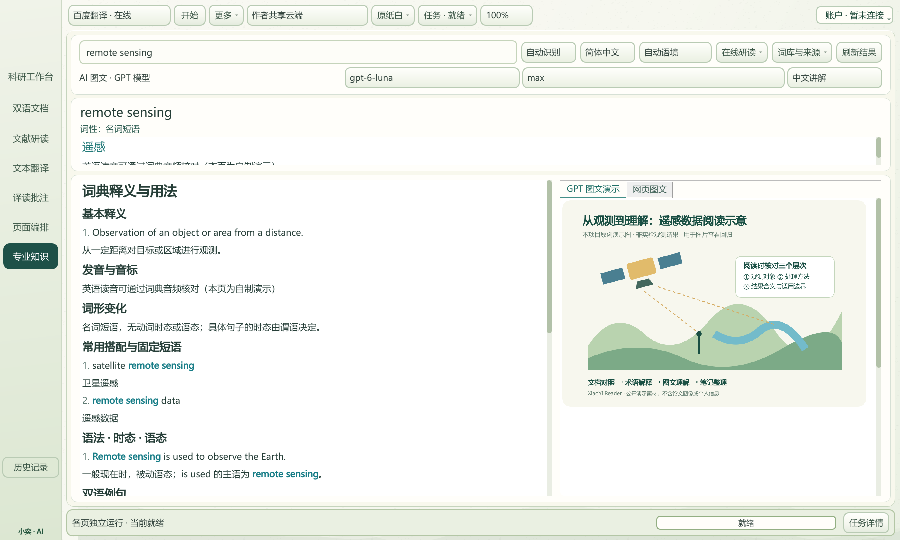
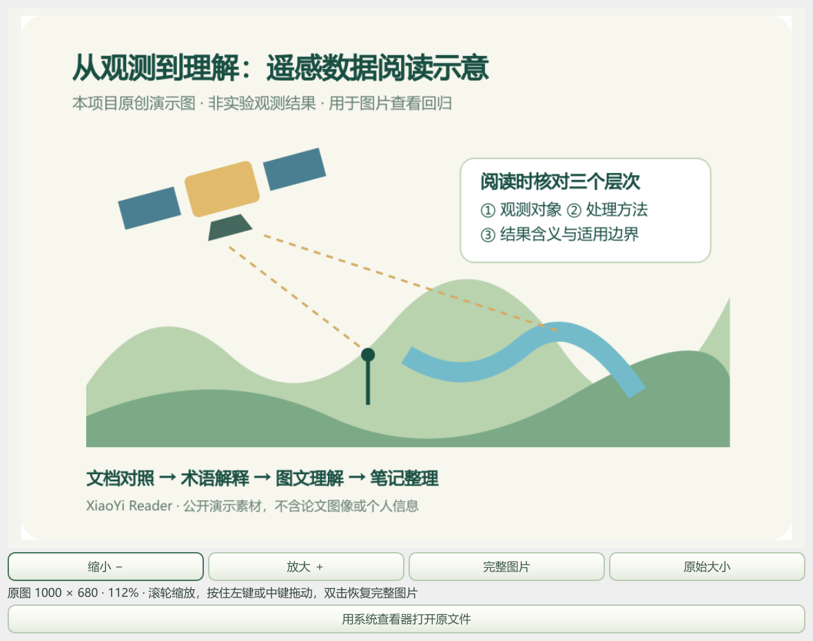
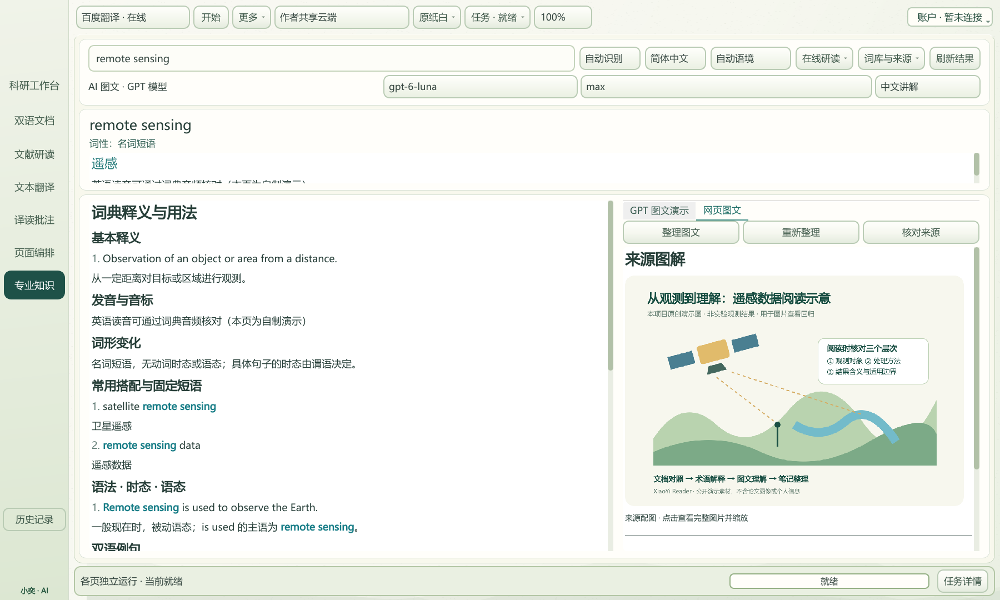

# 客户端测试截图

六张截图来自实际 1.43.4 打包客户端，采用隔离离屏 Qt 配置；素材为项目自行编写。原生截图未通过后期修图遮盖错误，页面标注了各自测试范围。它们不包含用户真实账号或第三方论文全文。

## 1. 双栏对照阅读

原文和译文并排查看，保留图像、公式与链接。截图使用自制中英演示文档。

## 2. 专注阅读

通过真实 F11 按键进入阅读界面，检查底部任务详情隐藏。

## 3. 三栏文献研读

原文、文献助手和选段译文默认约 60% / 22% / 18%；截图中的讲解为人工编写的界面测试内容。

## 4. 专业知识与语法

真实词典和专业解释控件，展示释义、搭配、语法、时态与语态。内容为自制测试条目。

## 5. 完整图片查看

在实际客户端点击图片打开查看窗口；验证完整显示、滚轮缩放和中键拖动。

## 6. 网页图文缓存

使用明确的本地缓存测试图文切换和滚动位置保留；不是对示例域名的实时网页抓取。

[检查与文件哈希](../docs/results/screenshot-verification.json) · [返回首页](../README.md)
